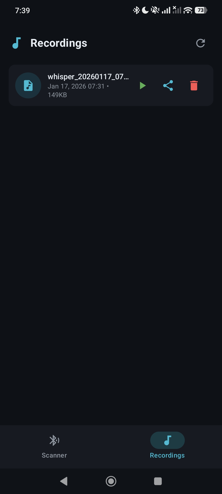
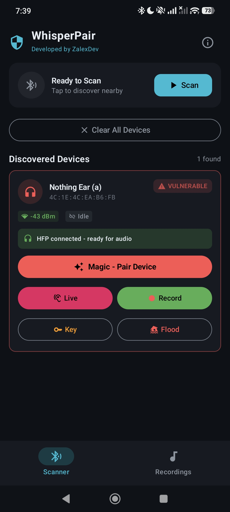
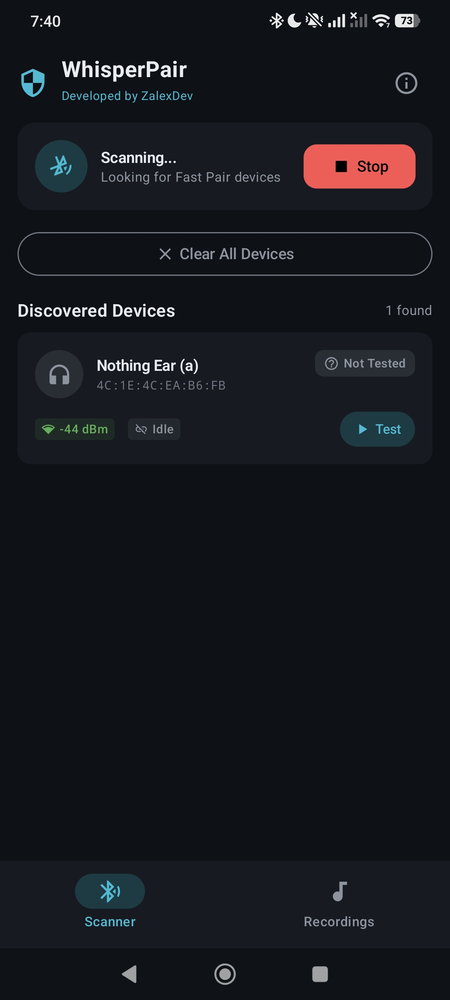
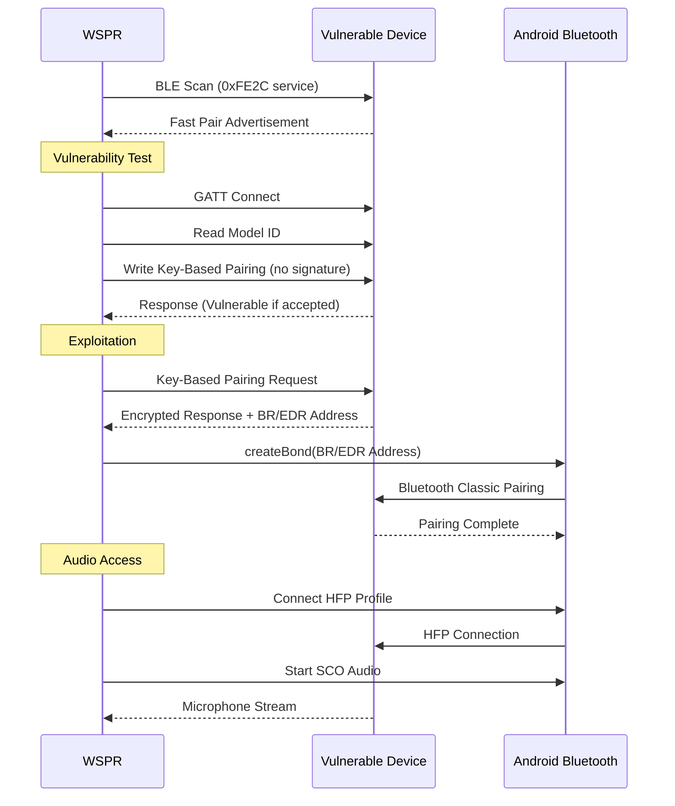
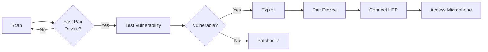

<p align="center">
  
</p>

<h1 align="center">WSPR</h1>
<p align="center">
  <strong>Vulnerability Scanner // Abhöreinrichung 5</strong>
</p>

<p align="center">
  <a href="https://developer.android.com"></a>
  <a href="https://kotlinlang.org"></a>
  <a href="LICENSE"></a>
</p>

<p align="center">
  <a href="#features">Features</a> •
  <a href="#installation">Installation</a> •
  <a href="#usage">Usage</a> •
  <a href="#how-it-works">How It Works</a>
</p>

---

## Overview

**WSPR** is a defensive security research tool that demonstrates the CVE-2025-36911 vulnerability in Google's Fast Pair protocol. This vulnerability affects millions of Bluetooth audio devices worldwide, allowing unauthorized pairing and potential microphone access without user consent.

> **Purpose:** Help security researchers, device manufacturers, and end-users identify vulnerable devices that need firmware updates.

## Features

| Feature | Description |
|---------|-------------|
| **BLE Scanner** | Discovers Fast Pair devices broadcasting the 0xFE2C service UUID |
| **Vulnerability Tester** | Non-invasive check if device is patched against CVE-2025-36911 |
| **Exploit Demonstration** | Full proof-of-concept for authorized security testing |
| **HFP Audio Access** | Demonstrates microphone access post-exploitation |
| **Live Listening** | Real-time audio streaming to phone speaker |
| **Recording** | Save captured audio as M4A files |

## Screenshots

<p align="center">
  
  
  
</p>

## Note on Find Hub Network (FMDN) tracking
This tool deliberately does not include FMDN provisioning functionality. While the vulnerability chain technically allows enrolling compromised devices into Google's Find Hub Network for persistent location tracking, I've chosen not to implement this capability. Converting someone's headphones into a covert tracking beacon crosses a clear ethical line from security research into stalkerware territory. The Account Key write and audio access demonstrations are sufficient to prove the vulnerability's severity.

## Installation

### Requirements
- Android 8.0 (API 26) or higher
- Bluetooth LE support
- Location permission (required for BLE scanning on Android) / Nearby Devices (A13+)

### Download
1. Go to [Releases](https://github.com/wspr-project/wspr-app/releases)
2. Download the latest `WSPR-vX.X.X.apk`
3. Enable "Install from unknown sources" if prompted
4. Install and grant required permissions

### Build from Source
```bash
git clone https://github.com/wspr-project/wspr-app.git
cd whisper-pair-app
./gradlew assembleDebug
```

## Usage

### 1. Scan for Devices
Tap **Scan** to discover nearby Fast Pair devices. Devices in pairing mode will show a "Pairing" badge.

### 2. Test Vulnerability
For devices **not** in pairing mode, tap **Test** to check if they're vulnerable. This is non-invasive and doesn't pair with the device.

| Status | Meaning |
|--------|---------|
| `VULNERABLE` | Device is affected by CVE-2025-36911 |
| `Patched` | Device has been updated with security fix |
| `Error` | Test inconclusive (device may be already paired) |

### 3. Exploit (Authorized Testing Only)
For vulnerable devices, tap **Do it** to demonstrate the full exploit chain:
- Key-Based Pairing bypass
- BR/EDR address extraction
- Bluetooth Classic bonding
- Account Key persistence

### 4. Audio Access
After successful pairing:
1. Tap **Connect Audio (HFP)** to establish Hands-Free Profile
2. Use **Live** for real-time listening through phone speaker
3. Use **Record** to save audio as M4A file

## How It Works



### Attack Flow



## Legal Disclaimer

> **This tool is provided for authorized security research and educational purposes only.**

- Only test devices you **own** or have **explicit written permission** to test
- Unauthorized access to computer systems is illegal in most jurisdictions
- The developers are not responsible for misuse of this tool
- This tool is intended to help identify vulnerable devices for remediation

**By using this software, you agree to use it responsibly and in compliance with all applicable laws.**

## See Also

| Tool | Description |
|------|-------------|
| [**Stryker**](https://github.com/Stryker-Defense-Inc/strykerapp) | Comprehensive mobile pentesting toolkit for Android |

## License

This project is licensed under the Apache License 2.0 - see the [LICENSE](LICENSE) file for details.

---

<p align="center">
  <sub>Built with ❤️ for the security research community</sub>
</p>
